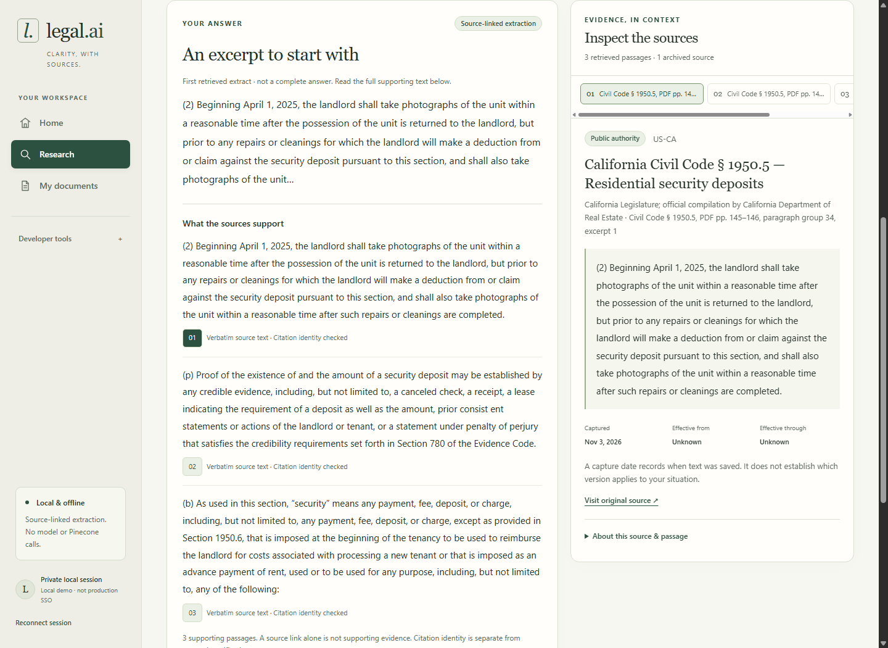
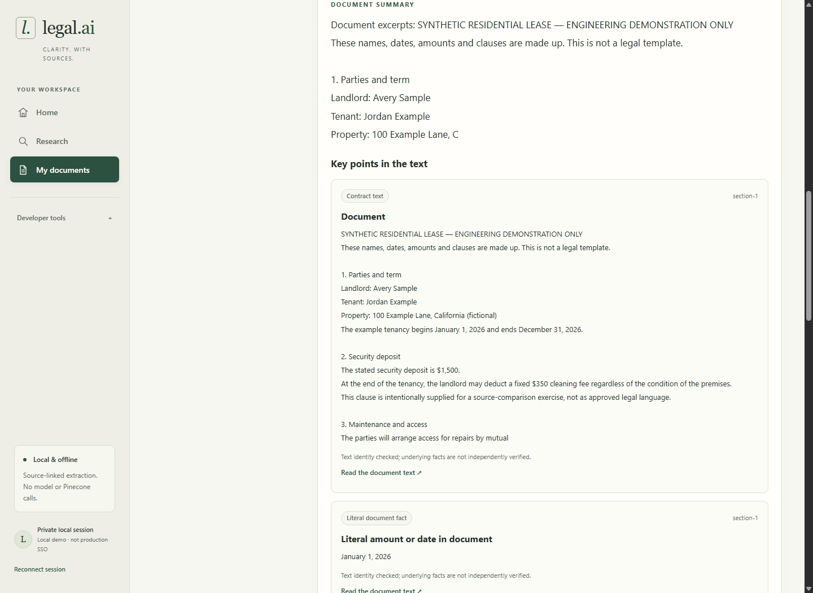
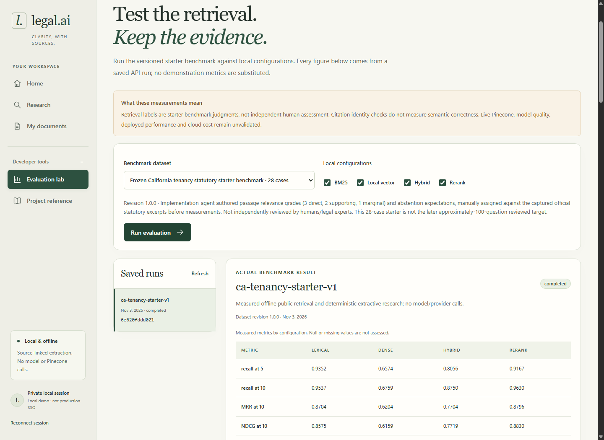

# legal.ai

**Evidence-grounded legal research & document intelligence**

A full-stack application for exploring authoritative legal sources, understanding documents, and inspecting the evidence behind each result.

**Offline local edition.** Explore three captured California residential landlord–tenant statutes through exact source-linked extracts.

<p align="center">
  
</p>

_Home: choose a task without configuring models or retrieval settings. Screenshots show the local production build, bundled statutory snapshots, and synthetic documents._

## Three workflows

- **Legal Research:** ask about the supported corpus, read source-linked extracts, and inspect exact passages and applicability limits. Unsupported questions receive an explanation of the evidence gap.
- **Document Intelligence:** upload PDF, DOCX, text, or Markdown; inspect extracted sections and literal findings; ask about document contents; and compare wording with public sources. Rule-based considerations are labeled separately from document text.
- **Retrieval Evaluation:** compare keyword search, local vector search, combined rankings, and deterministic reranking. Inspect measured results and individual cases, then reproduce the benchmark.

<p>
  <a href="artifacts/browser/research-desktop.png"></a>
  <a href="artifacts/browser/documents-desktop.png"></a>
  <a href="artifacts/browser/evaluations-desktop.png"></a>
</p>

_Research · Documents · Evaluation. Select a thumbnail to inspect the full-size workflow. The [walkthrough](docs/walkthrough.md) explains each interaction._

## How it works

**Next.js, React, and TypeScript** provide the customer workspace and developer tools. A same-origin proxy forwards browser requests to **FastAPI/Pydantic**. **SQLAlchemy** supports SQLite for native local use and PostgreSQL in Docker; private file bytes and application payloads are encrypted.

The engineering focus is inspectable evidence: bounded parsing, recoverable ingestion, workspace isolation, exact source/version references, and reproducible data/configuration/code fingerprints. Retrieval combines BM25 keyword search, deterministic local vectors, reciprocal rank fusion (merging ranked lists), and bounded reranking. Live Pinecone, trained embedding models, and generative LLMs are disabled; offline answers quote retrieved text. Prepared adapters use intercepted test transports.

See the [architecture diagram and design decisions](docs/design.md#architecture-at-a-glance), [typed API contract](docs/api-contract.md), and [Python/TypeScript clients](examples/).

## Run locally

Requires Python 3.12+, [uv](https://docs.astral.sh/uv/), Node.js 24 (the frontend supports 22.13+), and npm. Start from the repository root. Installing dependencies requires network access; normal application execution needs no provider key or model service.

**Terminal 1 — API and local database:**

```powershell
uv sync --frozen
uv run python scripts/bootstrap.py
uv run python scripts/verify_corpus.py
uv run --env-file .env alembic -c migrations/alembic.ini upgrade head
uv run --env-file .env uvicorn api.main:create_app --factory --host 127.0.0.1 --port 8000 --no-access-log
```

**Terminal 2 — frontend:**

```powershell
cd frontend
npm ci
npm run dev
```

Open **http://127.0.0.1:3000**. The API runs at **http://127.0.0.1:8000**. For a single-host PostgreSQL/container setup, use the [Docker recipe](docs/deployment.md#docker-compose); it is local execution, not public deployment.

The browser creates an isolated local workspace and keeps its session in an HttpOnly cookie, which browser JavaScript cannot read. An expired or lost session cannot recover the previous workspace; reconnecting creates a new one. This demo identity model is not production single sign-on.

Bootstrap generates ignored local configuration without printing secrets. `.runtime/` stores the database, encrypted files, and durable encryption key. Keep `.env` and runtime data out of Git, and preserve the key separately from encrypted backups. See [storage and session details](docs/security.md).

## Try it in a few minutes

1. From **Home**, choose **Ask a legal question** and try “What paperwork must accompany a security deposit deduction?” Read the extract, select a numbered citation, and inspect its exact source passage.
2. Ask about another jurisdiction or an unsupported historical date. The application should explain that the available evidence cannot answer it. A disconnected API produces a separate connection error with retry.
3. Open **My documents** and upload [the synthetic lease](samples/example-lease.txt), or choose **Try a synthetic sample lease**. Inspect sections, choose **Analyze & compare sources**, and ask what cleaning fee the document states. Findings describe text and considerations; they do not decide whether a clause is lawful.
4. Under **Developer tools**, open **Evaluation lab** and run the four local configurations. Inspect saved results, preserved failures, and the reproducibility manifest. **Project reference** contains corpus and API details.

Replacement removes the earlier current document from search once the new version is ready. Deletion revokes visibility and conservatively clears the workspace's saved custom search/research history; frozen public evaluation reports remain. Use synthetic documents for demonstrations. See the [full walkthrough](docs/walkthrough.md).

## Measured retrieval results

The [committed report](evaluations/reports/starter.json) uses **28 author-labeled engineering cases: 18 answerable and 10 required abstentions**, over three statutory sources and 122 passages. These are implementation-agent labels, not independent human legal judgments. Retrieval scores below are averaged over the 18 answerable cases.

| Local configuration           | Recall@10 | MRR@10 | nDCG@10 |
| ----------------------------- | --------: | -----: | ------: |
| BM25 keyword search           |     0.954 |  0.870 |   0.858 |
| Deterministic hash vectors    |     0.676 |  0.620 |   0.616 |
| Reciprocal rank fusion (RRF)  |     0.875 |  0.770 |   0.772 |
| RRF + deterministic reranking |     0.963 |  0.880 |   0.883 |

Recall measures how much labeled relevant evidence appears in the first ten results; MRR rewards the first relevant result; nDCG rewards placing more relevant passages higher. All range from zero to one, with higher values better.

**The local vector baseline fails the starter Recall@10 threshold of 0.70.** It hashes text features into fixed vectors with a small synonym mapping; it is not a trained semantic embedding model or a Pinecone benchmark. All configurations abstained on the ten required negative cases; the vector baseline also abstained on one answerable case. Failed cases remain in the report, and the [initial run](evaluations/reports/initial-2026-11-03.json) is retained.

The report preserves dataset/corpus versions, relevance labels, per-case results, configuration and code fingerprints, errors, and search/answer latency percentiles. Latency is measured locally for this small corpus and machine, not a production-service estimate. Observed provider calls, tokens, and dollars are zero; infrastructure cost is unestimated. Independent semantic support and legal correctness remain **null/unassessed**. Exact quotation and citation identity checks do not establish those qualities.

**Reproduce from the repository root:**

```powershell
uv run python -m evaluations datasets
uv run python -m evaluations run --output .local/evaluations/local-run.json
uv run pytest -q
cd frontend
npm test
npm run typecheck
npm run build
```

The new report goes under ignored `.local/`, preserving the committed comparison. See [evaluation design and thresholds](docs/design.md#benchmark-freeze-and-scoring), the [verification record](docs/verification.md), and the [second audit](docs/reaudit.md).

## Security and reliability

- **Workspace isolation:** the server determines ownership for documents, downloads, sources, runs, and evaluations. Clients cannot select another workspace by supplying an ID or namespace.
- **Private storage:** original files and private SQL content are encrypted; deletion and replacement purge retained custom history and revoke old source access.
- **Safe ingestion:** real PDF/DOCX parsing uses signature checks, size/expansion/text caps, and a process timeout. Scanned, encrypted, or active-content files can be rejected; OCR is deferred.
- **Recoverable operations:** durable ingestion states, idempotent retry, version checks, bounded requests/rates, Origin enforcement, and clear failure states have regression coverage.

The repository includes automated tests, secret/dependency scanning, Docker smoke checks, and browser verification. Stored evidence and the distinction between historical results and later reruns are documented in [verification](docs/verification.md). These checks do not constitute production certification or independent legal-quality review.

## Scope and deferred validation

The corpus covers only California Civil Code §§ 1950.5, 1950.6, and 1942.5 from a captured official 2026 DRE compilation. Its effective-date intervals are unvalidated; a capture date does not establish applicability to a situation. The application provides legal information and document understanding, not professional legal advice or a case-specific lawfulness determination.

Live Pinecone search, trained embeddings, generative-model output, independent human semantic/legal assessment, production identity/HTTPS/retention validation, public application deployment, and novice-user research remain deferred. Public GitHub source hosting is separate from deploying the application. Prepared integrations remain disabled; [future enablement requirements](docs/deployment.md#deferred-live-integration) describe the separate validation gate.

## Documentation, provenance, and rights

| Guide                                                                   | What it covers                                              |
| ----------------------------------------------------------------------- | ----------------------------------------------------------- |
| [Product walkthrough](docs/walkthrough.md)                              | Research, documents, evidence, and evaluation navigation    |
| [Design and architecture](docs/design.md)                               | Tradeoffs, contracts, retrieval, and acceptance thresholds  |
| [API contract](docs/api-contract.md) · [examples](examples/)            | Typed endpoints and minimal clients                         |
| [Security](docs/security.md) · [local/Docker setup](docs/deployment.md) | Isolation, storage, operations, and future deployment gates |
| [Verification](docs/verification.md) · [second audit](docs/reaudit.md)  | Measured checks, reproduced defects, fixes, and limits      |
| [Corpus rights and provenance](corpus/RIGHTS.md)                        | Capture source, hashes, scope, and government-edicts rights |
| [Attribution](docs/attribution.md)                                      | Cal Hacks predecessor credit and independent implementation |
| [Suggested GitHub metadata](docs/github-metadata.md)                    | Owner-review description, topics, and homepage guidance     |

The original [Cal Hacks legal.ai project](https://github.com/zessani/calhacks-legal-ai) was a four-person collaboration by [@zessani](https://github.com/zessani), [@mikey-il](https://github.com/mikey-il), [@caoash](https://github.com/caoash), and [@ThePhysic](https://github.com/ThePhysic). This repository is a fresh independent implementation inspired by that concept. See [attribution and supporting records](docs/attribution.md).

No predecessor implementation, prompts, assets, credentials, or databases were used.

**Project source: all rights reserved.** Public visibility does not grant an open-source or other software reuse license. See [LICENSE](LICENSE). Statutory corpus rights are documented separately in [corpus/RIGHTS.md](corpus/RIGHTS.md); no government or collaborator endorsement is claimed.
