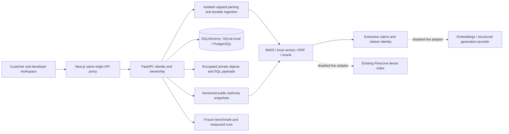

# legal.ai

A source-first legal research and document-intelligence application, with a reproducible retrieval evaluation lab. Built independently with Next.js/React/TypeScript, FastAPI/Pydantic, SQLAlchemy, and encrypted private document storage.

The local edition does real retrieval, file parsing, citation checks, document analysis and benchmark runs. **It is not the scripted HTML proposal.** It uses deterministic source extraction and explicitly named local vector/ranking baselines; it does not impersonate Pinecone or a language model.

**Scope:** three California residential landlord–tenant statutory sections captured from an official 2026 DRE compilation. Legal information for research and understanding, not professional legal advice. Effective-date coverage is unvalidated; no comprehensive/current-law or case-specific determination is promised.

## Run locally

Requires Python 3.12+, [uv](https://docs.astral.sh/uv/), Node.js 24 (22.13+ supported by the frontend), and npm. Normal execution is offline after dependencies have been installed; no model/API key is required.

```powershell
uv sync --frozen
uv run python scripts/verify_corpus.py
uv run python scripts/bootstrap.py
uv run --env-file .env alembic -c migrations/alembic.ini upgrade head
uv run --env-file .env uvicorn api.main:create_app --factory --host 127.0.0.1 --port 8000 --no-access-log
```

In a second terminal:

```powershell
cd frontend
npm ci
npm run dev
```

Open **http://127.0.0.1:3000**. A new isolated local-demo workspace is created automatically; an HttpOnly cookie keeps the session in that browser. SDK clients can use the returned bearer token. Losing/expiring a session does not grant access to another workspace. This is a local demo identity model, not production SSO. Do not expose the local servers to the public internet.

The ignored `.runtime/` holds the encrypted objects, database and durable key. `scripts/bootstrap.py` generates project-owned local configuration without printing secrets. Preserve the key separately from encrypted backups; deleting or replacing it makes existing private content unreadable. Never commit `.env`, `.runtime`, keys, uploads or session tokens.

## Try the product

1. **Research:** choose an example or ask a question such as “What paperwork must accompany a security deposit deduction?” Read the extractive answer, its exact passages and the remaining applicability limits. A citation identity check is separate from independently assessed semantic support.
2. **Documents:** upload `samples/example-lease.txt` or a permitted PDF, DOCX, text or Markdown document. Navigate sections, inspect literal findings and considerations, ask a document question, compare with public sources, replace/retry/download or confirm deletion. The sample's fixed cleaning clause is deliberately fictional, not an approved legal template.
3. **Coverage:** ask about another jurisdiction, unsupported historical date, missing private payment evidence or a case-specific lawfulness determination. The application should explain the evidence gap and abstain; source instructions cannot change authorization or tool policies.
4. **Developer tools:** run a measured four-configuration comparison, inspect candidate IDs/configuration/traces and download or reproduce the report. Advanced diagnostics are separate from the customer task flow.

## Evidence and evaluation

```powershell
uv run python -m evaluations datasets
uv run python -m evaluations run --output evaluations/reports/local-run.json
uv run pytest
cd frontend
npm test
npm run typecheck
npm run build
```

The frozen starter has **28 author-labeled cases: 18 answerable and 10 required abstentions**. Corpus bytes, passage IDs, labels, configuration and backend/harness identities are preserved before measurement. These are engineering labels, not an independently reviewed human legal benchmark. Approximately 100 carefully reviewed questions is a later target.

The included [measured report](evaluations/reports/starter.json) records these local results (rounded, not improvement claims):

| Local configuration | Recall@10 | MRR@10 | nDCG@10 |
| --- | ---: | ---: | ---: |
| Lexical BM25 | 0.954 | 0.870 | 0.858 |
| Normalized hash vectors | 0.676 | 0.620 | 0.616 |
| Reciprocal rank fusion | 0.875 | 0.770 | 0.772 |
| Fusion + deterministic rerank | 0.963 | 0.880 | 0.883 |

The dense local baseline underperforms; no claim is made that it represents trained semantic embeddings or live Pinecone. All configurations abstained on the ten required negative cases; dense also had a false abstention. Remaining retrieval failures and the initial run's discovered defects are retained. Quote/citation identity checks are mechanical; semantic correctness/support metrics requiring independent labels remain **null/unassessed**. Latency figures are actual local measurements for this small corpus and machine, not production service estimates. Observed provider calls/tokens/cost are zero; CPU/infrastructure cost is not estimated.

## Architecture



See [design and acceptance](docs/design.md), [API contract](docs/api-contract.md), [corpus provenance/rights](corpus/RIGHTS.md), [security and operations](docs/security.md), [deployment recipe](docs/deployment.md), and [developer examples](examples/).

## Security and reliability

- Server-derived workspace scope on document/source/search/download/analysis/deletion/run/evaluation routes; no trusted client namespace or owner filter.
- Opaque sessions, bearer/cookie conflict rejection, Origin enforcement, same-origin browser proxy, loopback binding and bounded rate/request limits.
- Real PDF/DOCX parsing with signature, expansion/page/text caps and a terminated subprocess timeout. Encrypted/scanned/unsafe documents are rejected explicitly; OCR is deferred.
- Private original bytes, SQL passages and run/analysis payloads are encrypted. Logs omit tokens and raw private content. Deletion revokes visibility and purges retained private text before recoverable object cleanup.
- Deterministic IDs, version hashes, ingestion failure/retry, replacement/current-version consistency and idempotent reconciliation.

These controls have local tests; they are not a claim of production certification, distributed abuse protection or a completed novice-user study.

## Offline and external validation gates

The user explicitly selected **offline only**. Live adapter tests use intercepted transports, not provider accounts. The current enforceable live budget is zero calls/tokens/dollars. Existing-index Pinecone and structured embedding/generation adapters are prepared with dimension, namespace, timeout, identity and budget checks; no index or model service was provisioned or contacted.

Actual live Pinecone search evidence, model semantic/legal quality, independent human labels, deployed HTTPS/identity/retention smoke tests and a novice participant study remain separate unexecuted gates. Public production deployment is not claimed. Docker images and the local PostgreSQL/API/production frontend were exercised with 22 passing synthetic container smoke checks; the saved report is [artifacts/container-smoke.json](artifacts/container-smoke.json).

## Repository and provenance

This is fresh implementation and Git history. The earlier Cal Hacks legal.ai project is a conceptual predecessor only; no prior implementation, prompts, assets, credentials or database were used. Original collaborator names have not been supplied, so no identities or contribution shares are invented; accurate named credit remains an attribution follow-up before public portfolio publication.

Project-source copyright and reuse status are recorded in [LICENSE](LICENSE). The selected statutory data has a separate government-edicts rights basis in [corpus/RIGHTS.md](corpus/RIGHTS.md). No government agency, law firm or original collaborator endorsement is claimed.
