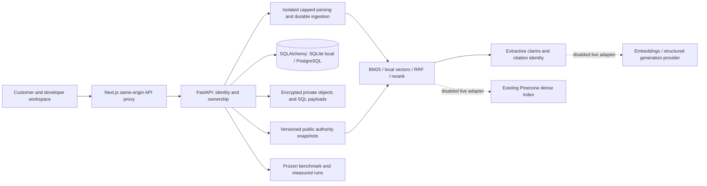

# legal.ai: L0 design and acceptance contract

## Authorized scope and completion claims

Build an independent local full-stack product matching the November 2026 specification and approved UX proposal. The user explicitly selected **offline only** on November 3, 2026. Implement and test live adapters with mock transports, but do not contact Pinecone/model providers, provision infrastructure or deploy. Private GitHub publication is authorized. A completed offline release does not constitute live Pinecone validation, LLM semantic accuracy, production deployment or novice-participant research; those external gates remain explicitly deferred.

## Product and architecture

Publication note: the initial implementation was delivered to a private GitHub repository. The source repository was observed as public during the later presentation handoff on November 3, 2026; application deployment remains unexecuted and project-source rights remain reserved. That handoff permits local documentation edits only, with separate authorization required for staging, commits, pushes, settings, or visibility changes. Original private-publication milestone wording below records the initial delivery scope.

Next.js/React/TypeScript frontend, FastAPI/Pydantic API, SQLAlchemy metadata with SQLite for deterministic local use and PostgreSQL production configuration/migration, encrypted local object-store adapter, and a recoverable local ingestion worker. A modular monolith keeps ownership, source versions and run identities explicit. No queue/Redis/agent framework until justified.

First visit: two tasks (research and document review). Customer navigation is separate from developer evaluation/reference. Unlike the proposal, real free-form research and file parsing call the local API. Every answer states its execution method. Source excerpts and support checks remain inspectable; provenance is progressive disclosure. Local developer comparisons use actual measurements, not proposal fixture numbers.

## Architecture at a glance

BM25 is keyword-based retrieval; local vectors are deterministic text-feature hashes. Reciprocal rank fusion (RRF) combines ranked lists, and the local reranker reorders a bounded candidate set. The dashed provider paths are prepared contracts, disabled in this release.

## Security domains and identity

Public authoritative snapshots are distinct from private workspace documents. Opaque, randomly generated session tokens map to server-owned workspace IDs; anonymous local-demo session creation always creates a new workspace and cannot select another workspace. Cookies are HttpOnly/SameSite; SDK bearer authorization is supported. Mutating cookie requests validate Origin; production cookies require HTTPS. Search, sources, upload/status/download/analysis/delete, evaluations and traces authorize ownership. Private vector namespaces derive only from server identity. Unauthenticated or cross-owner IDs return no data. Demo identities are not production SSO.

Private bytes and extracted content are encrypted at rest with a runtime-only generated or operator-supplied key; metadata excludes raw text in telemetry. Local keys/runtime/session tokens are ignored. Production requires secret-managed keys, encrypted PostgreSQL/object storage, HTTPS and configured identity/rate limits. No real confidential documents in public demonstrations.

## Corpus and applicability

Start with a small captured set of official California landlord–tenant statutory text. Record publisher, exact URL, capture timestamp, type, jurisdiction, source hash, version, section locators, rights basis and any confirmed effective-date bounds. Government-edict text is separated from copyrighted editorial/guidance material. Do not infer redistribution permission solely from public availability. Never represent an unknown effective date or a capture date as proof of historical applicability. Historical/date-specific questions require matching validated source bounds, otherwise abstain or expose the gap. Refresh is an explicit import of a new snapshot, not a continuous-coverage promise.

Synthetic private samples and adversarial test sources are labeled separately and excluded from public authority answers.

## Ingestion and retrieval

Validate file signature/type and size, cap DOCX uncompressed size/pages/text/chunks, reject encrypted/scanned/unsafe files, parse PDF with pypdf and DOCX with python-docx, normalize sections and deterministic content hashes. Lifecycle: uploaded -> extracting -> chunking -> indexing -> verifying -> ready; failed/interrupted jobs are retryable, and never searchable prematurely. Idempotent content/version IDs prevent duplicate chunks. Deletion revokes search immediately and reconciles objects/vectors/metadata with a visible pending/failure state; replacement cannot leave two current versions searchable.

BM25 is the exact-term baseline. The deterministic offline vector path is explicitly a local vector baseline, not Pinecone or a production semantic model. Hybrid is reciprocal-rank fusion with stable-passage deduplication; bounded deterministic reranking is labeled. A real Pinecone adapter targets an existing configured dense index, derives namespaces and filters on the server, validates dimensions and source identities, times out and never silently substitutes offline results for live failures. Model/provider/index/version/schema/metric, top-k, fusion/reranker/context budgets and dataset identity are captured per run. Exact Pinecone SDK/API shape must be verified against current official docs and a pinned package before implementation; no index creation side effects.

## Grounding and analysis

Offline generation is extractive and deterministic: quote retrieved source text with claim/passsage/source/version/locator identity. Do not label extractive identity validation as independent semantic verification. Research returns structured claims, coverage gaps, method and limits; out-of-corpus, unresolved historical applicability, low-relevance, injected instructions and case-specific legal determinations abstain explicitly. Provider outages are distinct from insufficient evidence; no silent model-memory fallback. Live generation adapters validate structured output and references, but are disabled by default and never called in this authorized run.

Document analysis exposes literal facts and clauses, summaries/Q&A grounded in private passages, clearly labeled rule-based considerations and a public-source comparison with uncertainty. No lawfulness/risk verdict, identity/payment verification, or allegations-as-facts. Input text cannot alter tools, authorization or cost controls.

## Evaluation and proposed acceptance thresholds

Use a versioned starter benchmark with passage-level relevance labels and explicit judgment provenance. Author/agent labels are not represented as independent human review. Approximately 100 carefully reviewed questions is a later dataset target, not a fabricated completion count. Include identifiers, paraphrases, multi-source, date/jurisdiction gaps, conflict, document Q&A, injection and unanswerable cases.

Release gates for the local deterministic suite: zero unauthorized document/source/trace leakage; zero fabricated citation identities or cross-version references; all injected-instruction safety cases preserve authorization and source-only behavior; out-of-corpus/date-unsupported/case-verdict negative cases abstain; upload caps/rejected files do not become searchable; recovery produces no duplicate current chunks; deletion/replacement remove old visibility. Retrieval thresholds are explicitly starter-benchmark gates: Recall@10 >= 0.70 and MRR@10 >= 0.60 on answerable public cases for at least one documented local configuration, with failures retained in the report. Do not require every strategy to improve. Numerical semantic support/correctness claims await independently reviewed labels. Report p50/p95 search/answer latency, errors, token/provider usage and cost basis; local CPU execution cost is not a cloud-price estimate.

CI includes meaningful unit/integration/browser tests, secret/dependency checks, build/type checks, migrations and Docker configuration validation. Record unavailable environments rather than claiming their tests ran. Bounded live-provider tests and deployed smoke gates are separately authorized future work, not fulfilled by mocks.

## Milestone gates

- L0: reviewed architecture/contracts, rights/source manifest, threat model, acceptance and offline boundaries.
- L1: working local web/API, real parsing, private isolation, lexical retrieval and ingestion recovery.
- L2: all retrieval paths/adapters/filter/version contracts implemented and offline tested; actual Pinecone evidence explicitly deferred by user.
- L3: structured extraction/answers/citations/abstention and document analysis, with provider-generation and independent semantic judgment limits visible.
- L4: reproducible stored evaluation and measured comparison report with honest judgment provenance.
- L5: tested local demo/reference/CI/operational docs, plus a deployment recipe; cloud deployment remains unexecuted. Final Astra clean review and verified private GitHub push.

L6 memory, OCR, speech, multilingual and extensive agent workflows remain optional.

## Concrete threat model and enforcement decisions

Threats include foreign-workspace object references, session fixation/CSRF, conflicting token identities, malicious PDF/DOCX decompression or active content, resource exhaustion, prompt injection, HTML/script in source text, stale vector visibility, deleted text in diagnostics, and source/version confusion. React renders all source/user text as text, never trusted HTML. Services bind loopback in local mode; there is no permissive wildcard CORS. The configured browser Origin allowlist initially contains only `http://127.0.0.1:3000` and `http://localhost:3000` (and explicit local integration-test origins). Any supplied unexpected Origin is rejected, including session creation. Cookie-authenticated mutations require an allowed Origin; authenticated SDK bearer requests may omit Origin. Unauthenticated SDK bootstrap may omit Origin but always creates a new workspace, is loopback/local-mode only, and is rate limited. Conflicting bearer and cookie sessions are rejected rather than choosing a more privileged identity. Authentication/cookie/token values are never logged.

Initial hard caps: 10 MiB upload/request, DOCX 25 MiB uncompressed/500 entries/100:1 per-entry expansion/no encrypted entries/path traversal/external relationships, PDF 150 pages/no encrypted or embedded/active-action content, extraction 400,000 characters/300 sections/400 chunks. Parsing runs in a separate spawned process terminated after 10 seconds; production adds OS memory/CPU/container isolation. Questions are capped at 2,000 characters; top-k is 1–10, reranking at 30 candidates, context at a conservative 1,800 UTF-8 bytes/token upper bound. Per-session requests are capped at 120/minute with upload/evaluation 10/minute and session bootstrap 20/minute per IP. Benchmark runs cap cases/configurations and public data; private workspace documents are never part of a shared/public benchmark. Rate counters are local single-process in this demo; distributed enforcement is a production gate.

Encryption covers private original bytes **and private SQL section/passage/run/analysis payloads**, not merely the original object. Filenames, ownership IDs, timestamps, status and safe operational metadata are not confidential-content encryption claims. A durable runtime-only Fernet key is generated once or supplied by an operator; losing it makes private content unreadable and must fail closed. Key rotation requires explicit decrypt/re-encrypt migration with old/new key access; automatic rotation is not claimed. Back up encrypted metadata/objects and key separately with access controls. Session expiry and retention are bounded/configured; deletion revokes immediately, purges private passages and persisted run/analysis text that could retain the document, then reconciles blob/vector deletion. Pending cleanup is visible and cannot restore searchability.

`Claim.identity_validated` checks the exact versioned passage/source identity and quote membership, not legal correctness or independent semantic support. `Finding.verified`, where retained for API compatibility, means only the literal finding has a matching private source locator/text; the frontend must label it as identity/text matching and never a verified legal finding. No inference is professionally reviewed or semantically certified. Retrieved contradictions/competing passages produce a coverage gap or abstention; selecting one quote is not resolution of conflicting authority.

## Disabled live profile and deployment decision

This release's enforceable live budget is **0 calls / 0 tokens / $0**. Optional prepared profile: Pinecone Python SDK 10.3.0 against an **existing** operator-specified serverless dense index host, cosine metric, 1,536 dimensions, model `text-embedding-3-small`, with no index create/update capability. Embeddings use an explicit adapter; local hash vectors are never sent to the semantic index or described as that model. Prepared grounded generation targets OpenAI Responses structured JSON output, proposed model `gpt-6-astra`, with schema/identity checks and source-only prompts. Account access, model/index compatibility and prices must be rechecked before separate authorization. No credentials are accessed or provider calls made for this release. Future authorized run profile must bound query count, embedding input, generation output, time, retry count and total observed cost; a zero or missing approval budget fails closed.

Offline reranking is a bounded deterministic term/identifier scorer over at most 30 candidates, not a neural reranker. Local dense is a documented normalized hashing baseline, not validated semantic embedding quality. Live reranker selection stays an explicit separately scoped experiment against that baseline, rather than a hidden provider fallback.

Deployment recipe: single-host Docker Compose with Next.js, FastAPI worker/application, PostgreSQL and encrypted object directory; a public deployment requires an HTTPS reverse proxy. Local convenience runs SQLite without Docker. The installed Docker daemon was initially stopped, then started for local verification: images build and the real PostgreSQL/API/production frontend pass synthetic container smoke tests. This does not validate a public deployment or production identity/TLS. The recipe includes readiness, migrations before serving, non-root processes, configured origins, secrets, backups and retention; no cloud service is provisioned or published.

Official integration references checked November 3, 2026: https://sdk.pinecone.io/python/reference/sync-index.html ; https://sdk.pinecone.io/python/how-to/vectors/upsert-and-query.html ; https://developers.openai.com/api/docs/guides/embeddings ; https://developers.openai.com/api/docs/guides/structured-outputs ; https://developers.openai.com/api/docs/models/gpt-6-astra . These document contracts, not evidence of account-level availability or a live successful run.

## Benchmark freeze and scoring

Freeze corpus bytes/hashes, explicit passage IDs, dataset revision, candidate configuration and label provenance before producing a comparison. Recall@k is the fraction of labeled relevant passage IDs retrieved among all relevant IDs for an answerable case; MRR@10 is reciprocal first relevant rank, or zero for no hit, averaged over answerable cases. Binary/graded nDCG uses explicit stored relevance grades and ideal ordering; abstention cases are not silently included in retrieval denominators. Report per-category and answerable/unanswerable counts. Applicability and cross-owner tests are separate negative gates. Correctness/semantic support metrics requiring independent labels are null/unassessed until those labels exist. Preserve failing cases, configuration and source versions; no benchmark tuning may silently rewrite frozen labels.
